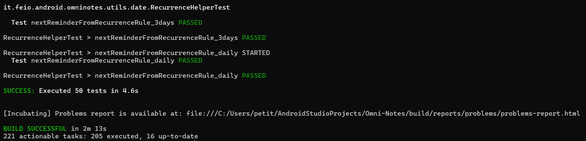

# Omni-Notes 开源软件分析与维护实践记录

## 一、 团队成员与分工
本项目采用 2 人结对（Pair Programming）模式进行分布式协同开发。
*   **黄秀**：主要负责 UI 视图与交互逻辑的精读标注，主导界面相关功能的维护与扩展。
*   **罗丹丹**：主要负责数据持久化与底层系统服务的精读标注，主导核心逻辑与异步任务的维护。

## 二、 开发环境与技术栈
*   **开发工具**：Android Studio
*   **构建工具**：Gradle (AGP 8.13.2)
*   **SDK 版本**：Min SDK 24 / Target SDK 36 / Compile SDK 36
*   **版本控制**：Git & GitHub (Fork + Pull Request 协同流)

## 三、 Git 协同规范
为保证代码质量与合并安全，我们小组遵守以下分支规范：
*   `main`：受保护分支，存放最终交付的稳定版本。
*   `develop`：开发主干分支，用于集成团队成员的日常开发成果。
*   `feat-A` / `feat-B`：个人开发分支，分别对应两人的日常代码修改与文档编写。其中，黄秀对应 feat-A ,罗丹丹负责 feat-B 。
*   **Commit 规范**：`[标签] 成员 - 描述`。

## 四、 里程碑与进度记录

### 阶段一：寻找合适开源软件与环境搭建（第7周周末）
* 预期目标：建好两份共享文档骨架、对齐分工与 Git 规范；初步梳理源码核心类、数据库结构、项目基础规模，为后续泛读准备素材。
* **10月24日**：Fork 原仓库（原仓库地址为：https://github.com/federicoiosue/Omni-Notes ，
  * 罗丹丹：负责建立开发分支，本地单元测试环境校验（**测试通过率 100%**，附测试截图）:
  
  * 黄秀：负责检验检查 gradle.properties 中的 COMPILE_SDK=36，确认 SDK Manager 中已安装对应版本。
* **10月25日**：
  * 黄秀：完成对 DetailFragment.java 的代码泛读。针对该类的核心业务逻辑，整理列举了核心方法清单。
  * 罗丹丹梳理了 DbHelper.java 的方法清单及绘画 create.sql 的ER图。

### 阶段二：结对泛读与架构摸底（第8周）
*   预期目标：通读项目，理清整体架构、模块职责，产出架构图与功能 - 类映射表；上手 SonarQube，完成质量报告初稿；启动代码注释；确定 2 个维护任务，产出第一篇博客。
*  **10月24日**：
   * 黄秀：今日完成初步泛读，梳理了 intro 与 widget 包的作用，明确了 IntroActivity、WidgetProvider 等核心类的职责，并理清了这两个子系统内各类的继承与依赖关系。
   * 罗丹丹：
*  **10月27日**：
   * 黄秀：和罗丹丹合绘Omni-Notes开源软件包，了解根包里面的部分包的作用和类间关系。
   * 罗丹丹：
*  **10月28日**：
   * 黄秀：
   * 罗丹丹：
*  **10月29日**：
   * 黄秀：
   * 罗丹丹：
*  **10月30日**：
   * 黄秀：
   * 罗丹丹：
*  **10月31日**：
   * 黄秀：
   * 罗丹丹：
*  **11月1日**：
   * 黄秀：
   * 罗丹丹：

### 阶段三：深度精读与设计（第9周）
*   预期目标：完成精读，每人注释≥2000 行；理解复杂业务逻辑，持续补充质量报告；完成维护方案、UML 修改类图；交叉评审注释，产出第二篇博客。
*  **11月2日**：
    * 黄秀：
    * 罗丹丹：
*  **11月3日**：
    * 黄秀：
    * 罗丹丹：
*  **11月4日**：
    * 黄秀：
    * 罗丹丹：
*  **11月5日**：
    * 黄秀：
    * 罗丹丹：
*  **11月6日**：
    * 黄秀：
    * 罗丹丹：
*  **11月7日**：
    * 黄秀：
    * 罗丹丹：
*  **11月8日**：
    * 黄秀：
    * 罗丹丹：
### 阶段四：功能维护与测试（第10周）
*   预期目标：按设计实现两个新增功能，保持和原有代码风格一致；编写 JUnit 测试，保证测试全部通过；联调 App、截取功能截图；产出第三篇博客。
*  **11月9日**：
    * 黄秀：
    * 罗丹丹：
*  **11月10日**：
    * 黄秀：
    * 罗丹丹：
*  **11月11日**：
    * 黄秀：
    * 罗丹丹：
*  **11月12日**：
    * 黄秀：
    * 罗丹丹：
*  **11月13日**：
    * 黄秀：
    * 罗丹丹：
*  **11月14日**：
    * 黄秀：
    * 罗丹丹：
*  **11月15日**：
    * 黄秀：
    * 罗丹丹：
### 阶段五：任务收尾与学习心得（第11周）
*   任务：本周我们主要校对两份文档，完善内容后导出 PDF；录制演示视频、制作答辩 PPT；整理源码、Git 记录、博客链接；开展答辩彩排，逐项核对材料，平台上传交付物。
    我们的产出导入：定稿 PDF、演示视频、PPT、源码、截图、博客链接、提交回执。
* 学习心得：通过近五周的实践学习，我们组两位成员逐步熟悉了解了 Omni-Notes 项目的整体开发与维护流程，也各自收获了不同的感悟：
  * 黄秀：
  * 罗丹丹：

---
*本文档由 黄秀 与 罗丹丹 共同维护，随项目进度持续更新。*