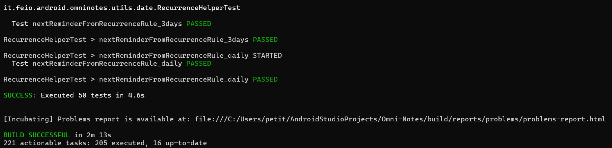

# Omni-Notes 开源软件分析与维护实践记录

## 一、 团队成员与分工
本项目采用 2 人结对（Pair Programming）模式进行分布式协同开发。
*   **黄秀**：主要负责 UI 视图与交互逻辑的精读标注，主导界面相关功能的维护与扩展。
*   **罗丹丹**：主要负责数据持久化与底层系统服务的精读标注，主导核心逻辑与异步任务的维护。

## 二、 开发环境与技术栈
*   **开发工具**：Android Studio
*   **构建工具**：Gradle (AGP 8.13.2)
*   **SDK 版本**：Min SDK 24 / Target SDK 36 / Compile SDK 36
*   **版本控制**：Git & GitHub (Fork + Pull Request 协同流)

## 三、 Git 协同规范
为保证代码质量与合并安全，我们小组遵守以下分支规范：
*   `main`：受保护分支，存放最终交付的稳定版本。
*   `develop`：开发主干分支，用于集成团队成员的日常开发成果。
*   `feat-A` / `feat-B`：个人开发分支，分别对应两人的日常代码修改与文档编写。其中，黄秀对应 feat-A ,罗丹丹负责 feat-B 。
*   **Commit 规范**：`[标签] 成员 - 描述`。

## 四、 里程碑与进度记录

### 阶段一：寻找合适开源软件与环境搭建（第7周周末）
* 预期目标：建好两份共享文档骨架、对齐分工与 Git 规范；初步梳理源码核心类、数据库结构、项目基础规模，为后续泛读准备素材。
* **10月24日**：Fork 原仓库（原仓库地址为：https://github.com/federicoiosue/Omni-Notes ，
  * 罗丹丹：负责建立开发分支，本地单元测试环境校验（**测试通过率 100%**，附测试截图）:
  
  * 黄秀：负责检验检查 gradle.properties 中的 COMPILE_SDK=36，确认 SDK Manager 中已安装对应版本。
* **10月25日**：
  * 黄秀：完成对 DetailFragment.java 的代码泛读。针对该类的核心业务逻辑，整理列举了核心方法清单。
  * 罗丹丹梳理了 DbHelper.java 的方法清单及绘画 create.sql 的ER图。

### 阶段二：结对泛读与架构摸底（第8周）
*   预期目标：通读项目，理清整体架构、模块职责，产出架构图与功能 - 类映射表；上手 SonarQube，完成质量报告初稿；启动代码注释；确定 2 个维护任务，产出第一篇博客。
*  **10月24日**：
   * 黄秀：今日完成初步泛读，梳理了 intro 与 widget 包的作用，明确了 IntroActivity、WidgetProvider 等核心类的职责，并理清了这两个子系统内各类的继承与依赖关系。
   * 罗丹丹：
*  **10月27日**：
   * 黄秀：和罗丹丹合绘Omni-Notes开源软件包，了解根包里面的部分包的作用和类间关系。
   * 罗丹丹：
*  **10月28日**：
   * 黄秀：今日完成《泛读报告》初稿撰写，涵盖功能描述、及15项代码模块与核心方法的对应关系表
   * 罗丹丹：
*  **10月29日**：
   * 黄秀：完成了DetailFragment.java 1-200行代码的精读，其中主代码大约100行，熟悉成员变量和textLinkClickListener 变量定义及内部的方法
   * 罗丹丹：
*  **10月30日**：
   * 黄秀：完成了 DetailFragment.java 第 200-450 行代码的精读，梳理了 Fragment 核心生命周期方法
   * 罗丹丹：
*  **10月31日**：
   * 黄秀：完成了 DetailFragment.java 第 450-550 行代码的精读。深入剖析了 handleIntents() 这一核心调度方法，梳理了页面如何响应来自外部的各类跳转意图及数据解析流程。
   * 罗丹丹：
*  **11月1日**：
   * 黄秀：确定新增功能“新建便签取消机制”，“按时间修改快速排序”，“清空已完成待办项”，并和罗丹丹合写了第八周博客。
   * 罗丹丹：
*  **10月26日**：
   * 黄秀：
   * 罗丹丹：对it.feio.android.omninotes软件包进行大致泛读，分析了解了async包、db包、helpers包、models包、utils包各自的作用以及各个包内的各个类之间的关系。
*  **10月27日**：
   * 黄秀：
   * 罗丹丹：和黄秀合绘Omni-Notes开源软件包图，了解feio.android.omninotes软件包剩下的类之间的关系。
*  **10月28日**：
   * 黄秀：
   * 罗丹丹：利用SonarQube对Omni-Notes开源软件进行代码质量测试，并泛读主要类对代码进行人工质量分析，完成了Omni-Notes开源软件质量分析报告初稿。
*  **10月29日**：
   * 黄秀：
   * 罗丹丹：完成了DbHelper.java 1-200 行代码的精读，了解每个方法/关键块的具体作用是什么，以及为什么要这样用。
*  **10月30日**：
   * 黄秀：
   * 罗丹丹：继续精读，完成了DbHelper.java 201-400行代码，了解代码作用以及为什么这么做。
*  **10月31日**：
   * 黄秀：
   * 罗丹丹：继续精读DbHelper.java，对401-500行进行了批注，了解其方法类的作用以及为什么这么写。
*  **11月1日**：
   * 黄秀：
   * 罗丹丹：确定新增功能"笔记置顶 Pin"，缺陷修改确认为SonarQube扫出的 5 个 Bug 全修 + Security.kt 的 MD5/DES 弱加密换 AES + AndroidManifest 两条安全配置，并和黄秀一起合写了第八周的技术博客。

### 阶段三：深度精读与设计（第9周）
*   预期目标：完成精读，每人注释≥2000 行；理解复杂业务逻辑，持续补充质量报告；完成维护方案、UML 修改类图；交叉评审注释，产出第二篇博客。
*  **11月2日**：
    * 黄秀：完成了 DetailFragment.java 第 550-800 行代码的精读，了解每个方法具体作用以及原因
    * 罗丹丹：
*  **11月3日**：
    * 黄秀：今日精读了 DetailFragment 的便签保存流程、拍照录像调用及菜单路由逻辑，以及 ListFragment 的列表数据加载与滑动交互机制。
    * 罗丹丹：
*  **11月4日**：
    * 黄秀：精读 DetailFragment 的外部结果回传、修改回滚及删除/归档/还原五个方法，并进行批注，梳理便签生命周期末端链路，了解方法块的作用。
    * 罗丹丹：
*  **11月5日**：
    * 黄秀：今日精读了 ListFragment 的视图初始化与生命周期核心流程，梳理了状态恢复、RecyclerView 驱动配置、列表动画与空视图处理等 UI 渲染机制
    * 罗丹丹：
*  **11月6日**：
    * 黄秀：今日精读 MainActivity 和 ListFragment 生命周期和相应方法块，了解其相应作用；与罗丹丹合绘 UI 层设计类图，填写报告中有关内容
    * 罗丹丹：
*  **11月7日**：
    * 黄秀：今日补绘报告 1.2 节 it.feio.android.omninotes、intro、widge 子系统的原始代码类图。
    * 罗丹丹：
*  **11月8日**：
    * 黄秀：今日与罗丹丹合写第九周博客 -《代码精读与SonarQube质量分析实战》
    * 罗丹丹：
    * 黄秀：
    * 罗丹丹：精读DbHelper.java 第501-800行代码，理解方法块的作用和原因。
*  **11月3日**：
    * 黄秀：
    * 罗丹丹：精读完DbHelper剩余所有代码，理解方法快作用。
*  **11月4日**：
    * 黄秀：
    * 罗丹丹：完成 Security.kt、ReminderHelper.java、SaveNoteTask.java 的精读任务，并了解各个方法块的作用。
*  **11月5日**：
    * 黄秀：
    * 罗丹丹：精读 Stats/Note/Category/Tag，了解每个板块或者方法块的作用，并完善了质量分析报告。
*  **11月6日**：
    * 黄秀：
    * 罗丹丹：完成精读标注量的统计核对；绘制 db、models、utils 三个子系统的设计类图，与黄秀合绘根包 UI 层设计类图；完成报告 3.1—3.3 正文，含 9 项维护内容表、四张子系统类图的设计说明与维护代码质量分析。
*  **11月7日**：
    * 黄秀：
    * 罗丹丹：补绘报告 1.2 节 async、helpers 两个子系统的原始代码类图，与 db、models、utils 共同凑齐五个包的类图；逐图核对 1.2 正文中五个包的类关系描述；审阅 3.1 九项维护内容表与 3.2、3.3 正文。
*  **11月8日**：
    * 黄秀：
    * 罗丹丹：与黄秀共同撰写第 9 周博客《代码精读与 SonarQube 质量分析实战》，负责 DbHelper 事务与安全机制、SonarQube 报告解读、精读方法复盘三部分。
### 阶段四：功能维护与测试（第10周）
*   预期目标：按设计完成 9 项维护内容（缺陷修复 5 项、功能新增 4 项），保持和原有代码风格一致；编写 JUnit 测试，保证测试全部通过；联调 App、截取功能截图并完成 3.4 节维护后的软件原型说明；产出第三篇博客。
*  **11月9日**：
    * 黄秀：完成 DetailFragment 的“取消新建便签”功能开发，并在模拟器上完成功能测试与截图留存。
    * 罗丹丹：完成4项缺陷修复（S4973、S2154、S2583、S5332、S6358），解决 SublimePicker 的 manifest 合并冲突，构建通过并复扫 SonarQube，问题数由 23 降至 16。
*  **11月10日**：
    * 黄秀：
    * 罗丹丹：完成 Security.kt 安全改造（MD5→SHA-256、DES→AES-256/GCM），保留旧密文与旧密码摘要的兼容路径，构建通过并复扫 SonarQube，问题数由 16 降至 11，达到阶段目标。
*  **11月11日**：
    * 黄秀：
    * 罗丹丹：完成笔记置顶 Pin 的数据层改造，含字段与 Parcelable 镜像、数据库升级至 626 与置顶优先排序，构建通过并验证旧库升级、全新安装两条路径。
*  **11月12日**：
    * 黄秀：
    * 罗丹丹：完成笔记置顶 Pin 的界面层实现：编辑页溢出菜单新增「置顶笔记」与「取消置顶」，原通知栏功能更名为「在通知栏置顶」；列表项新增图钉标识，规格与锁图标一致。补充单元测试 3 例、仪器测试 3 例，JVM 与模拟器实测均通过，构建通过。
*  **11月13日**：
    * 黄秀：
    * 罗丹丹：完成全量单元测试，53 个用例全部通过；重启 SonarQube 并复扫，问题数维持 11 项（相对 10 月 28 日基线 23 项累计关闭 12 项），确认置顶功能界面层代码未引入新问题。
*  **11月14日**：
    * 黄秀：
    * 罗丹丹：
*  **11月15日**：
    * 黄秀：
    * 罗丹丹：
### 阶段五：任务收尾与学习心得（第11周）
*   任务：本周我们主要校对两份文档，完善内容后导出 PDF；录制演示视频、制作答辩 PPT；整理源码、Git 记录、博客链接；开展答辩彩排，逐项核对材料，平台上传交付物。
    我们的产出导入：定稿 PDF、演示视频、PPT、源码、截图、博客链接、提交回执。
* 学习心得：通过近五周的实践学习，我们组两位成员逐步熟悉了解了 Omni-Notes 项目的整体开发与维护流程，也各自收获了不同的感悟：
  * 黄秀：
  * 罗丹丹：

---
*本文档由 黄秀 与 罗丹丹 共同维护，随项目进度持续更新。*